  

  
  
  
  

  
  
  

<h2 align="center">TECH STACK</h2>

  

  

<h2 align="center">STACK BREAKDOWN</h2>

  

<h2 align="center">ACTIVITY PANEL</h2>

  

<h2 align="center">CONTRIBUTION MAP</h2>

  

<h2 align="center">CONNECT WITH ME</h2>

  
  
  

