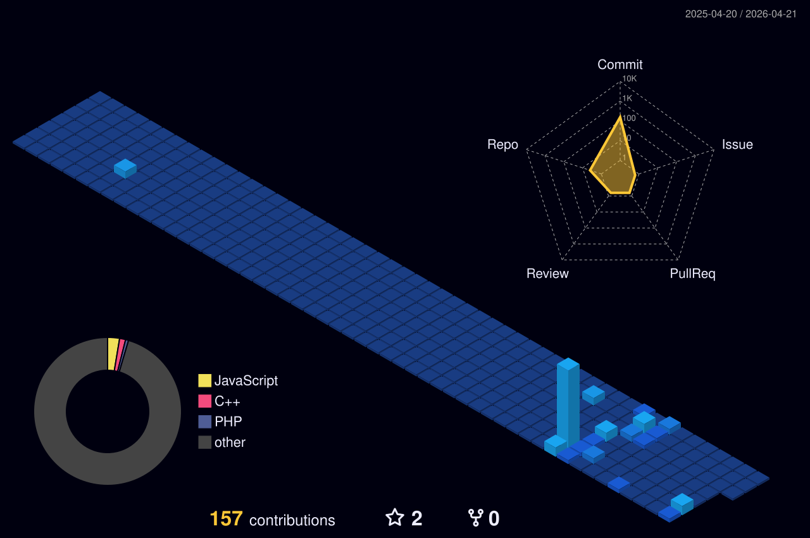

  

  
  
  
  

<h2 align="center">TECH STACK</h2>

  

   
  

<h2 align="center">STACK BREAKDOWN</h2>

  

<h2 align="center">ACTIVITY PANEL</h2>

<table align="center">
<tr>
<td align="center">
  
</td>
<td align="center">
  
</td>
</tr>
<tr>
<td colspan="2" align="center">
  
</td>
</tr>
</table>

<h2 align="center">3D CONTRIBUTION GRAPH</h2>

  

<h2 align="center">CONNECT WITH ME</h2>

  
  
  

